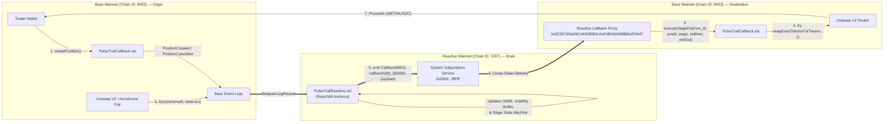
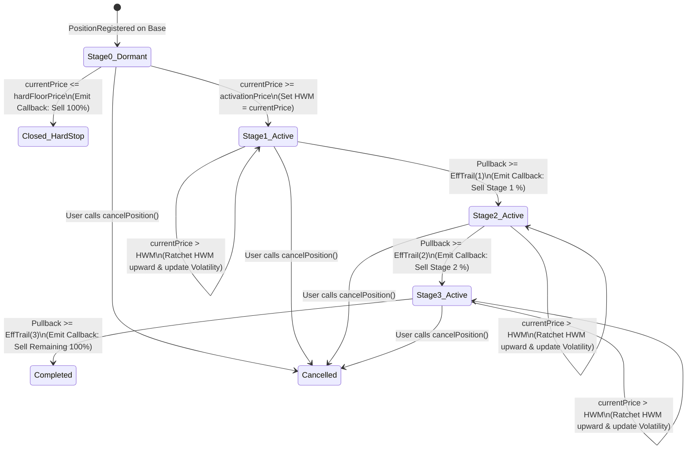
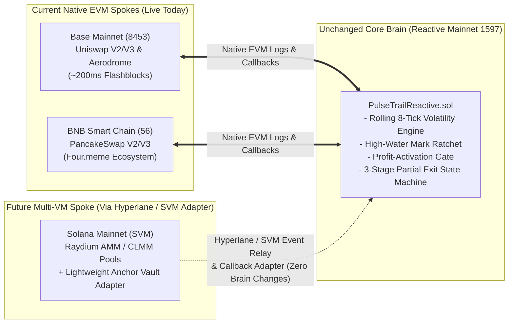

# PulseTrail — System Architecture & Technical Specification

## 1. High-Level Cross-Chain Topology

PulseTrail operates as a closed-loop cross-chain state machine spanning **Base Mainnet (`8453`)** (Origin & Destination Chain) and **Reactive Mainnet (`1597`)** (Reactive Execution Network).



---

## 2. Network Constants & Canonical Addresses (Mainnet)

| Parameter | Reactive Mainnet | Base Mainnet (Primary) | Ethereum Mainnet | Arbitrum One |
| :--- | :--- | :--- | :--- | :--- |
| **Chain ID** | `1597` | `8453` | `1` | `42161` |
| **RPC Endpoint** | `https://mainnet-rpc.rnk.dev/` | `https://mainnet.base.org` | `https://eth.llamarpc.com` | `https://arb1.arbitrum.io/rpc` |
| **Block Explorer** | `https://reactscan.net` | `https://basescan.org` | `https://etherscan.io` | `https://arbiscan.io` |
| **System / Callback Proxy** | Service: `0x0000000000000000000000000000000000fffFfF`<br>System: `0x8888888888888888888888888888888888888888` | `0x0D3E76De6bC44309083cAAFdB49A088B8a250947` | `0x1D5267C1bb7D8bA68964dDF3990601BDB7902D76` | `0x4730c58FDA9d78f60c987039aEaB7d261aAd942E` |
| **Uniswap V2 Router** | N/A | `0x4752ba5DBc23f44D87826276BF6Fd6b1C372aD24` | `0x7a250d5630B4cF539739dF2C5dAcb4c659F2488D` | `0x4752ba5DBc23f44D87826276BF6Fd6b1C372aD24` |

### Subscribed Event Topic0 Hashes
- **Uniswap V2 `Sync(uint112 reserve0, uint112 reserve1)`**:
  `0x1c411e9a96e071241c2f21f7726b17ae89e3cab4c78be50e062b03a9fffbbad1`
- **PulseTrail `PositionRegistered(...)`**:
  Computed via `keccak256("PositionRegistered(uint256,address,address,address,bool,uint256,uint256,uint256,uint256,uint16[3],uint16[3],uint16,uint16)")`
- **PulseTrail `PositionCancelled(uint256)`**:
  Computed via `keccak256("PositionCancelled(uint256)")`

---

## 3. Smart Contract Architecture

### 3.1 `PulseTrailCallback.sol` (Base Mainnet — `8453`)

Deployed on Base Mainnet, this contract serves three roles:
1. **User Vault & Registration Gateway:** Escrows the user's ERC-20 tokens (measuring exact post-tax balances received) and emits `PositionRegistered` so the Reactive contract automatically initializes tracking.
2. **Pre-Flight Risk Verifier:** Exposes `checkPoolLiquidity()` and `simulateSellDryRun()` views to detect thin liquidity or honeypots before registration.
3. **Authenticated Swap Executor:** Inherits `AbstractCallback` from `reactive-lib`. Receives cross-chain callbacks from the Base Callback Proxy (`0x0D3E76De6bC44309083cAAFdB49A088B8a250947`), verifies `rvmIdOnly`, and executes slippage-protected swaps via `try / catch`.

#### Storage Layout (`PulseTrailCallback.sol`)
```solidity
enum PositionStatus {
    Active,     // 0: Currently monitored
    Completed,  // 1: All 3 stages exited cleanly
    Cancelled,  // 2: User withdrew tokens manually
    Failed      // 3: Router swap reverted (e.g., honeypot/excessive slippage)
}

struct CallbackPosition {
    address owner;              // Trader wallet receiving swap proceeds
    address tokenIn;            // Token being trailed/sold
    address tokenOut;           // Quote token (WETH or USDC)
    address pair;               // Uniswap V2 Pair being monitored
    uint256 initialBalance;     // Actual post-tax tokens received at registration
    uint256 remainingBalance;   // Current unswapped tokens remaining
    uint256 totalProceeds;      // Cumulative quote tokens sent to owner
    uint16 maxSlippageBps;      // Max slippage tolerance (e.g., 300 = 3%)
    uint8 currentStage;         // Last executed stage (0, 1, 2, 3)
    PositionStatus status;      // Lifecycle state
    uint256 createdAt;          // Timestamp of creation
}
```

---

### 3.2 `PulseTrailReactive.sol` (Reactive Mainnet — `1597`)

Deployed on Reactive Mainnet, this contract inherits `IReactive` and `AbstractReactive`. It maintains dual state:
- **RNK Network Context (`!vm`):** Manages event subscriptions via `service.subscribe(...)` on `0x0000000000000000000000000000000000fffFfF`.
- **ReactVM Context (`vmOnly`):** Executes `react(LogRecord calldata log)` inside the isolated ReactVM environment whenever a subscribed Base Mainnet log arrives.

#### Storage Layout (`PulseTrailReactive.sol`)
```solidity
uint8 constant BUFFER_SIZE = 8;

struct ReactivePosition {
    uint256 positionId;
    address owner;
    address pair;
    bool isToken0;                  // True if tokenIn is token0 in the pair
    uint256 entryPrice;             // Scaled by 1e18 (tokenOut per tokenIn)
    uint256 activationPrice;        // Price required to enter Stage 1
    uint256 hardFloorPrice;         // Optional emergency stop price (0 = disabled)
    uint256 highWaterMark;          // Highest price observed since activation
    uint256 initialBalance;         // Initial token amount
    uint256 remainingBalance;       // Remaining token amount
    uint16[3] baseTrailBps;         // Base trail per stage (e.g., [800, 600, 500])
    uint16[3] exitPortionBps;       // Exit % per stage (e.g., [4000, 3000, 3000])
    uint16 volatilityMultiplierBps; // Sensitivity (e.g., 15000 = 1.5x volatility)
    uint16 maxWideningBps;          // Cap on adaptive widening (e.g., 1000 = +10%)
    uint16 maxSlippageBps;          // Slippage tolerance for minAmountOut calc
    uint8 currentStage;             // 0 = Dormant, 1 = Stage 1, 2 = Stage 2, 3 = Stage 3, 4 = Closed
    bool active;                    // False once closed or cancelled
    // Rolling Volatility Buffer
    uint256[8] priceBuffer;
    uint8 bufferIndex;
    uint8 bufferCount;
    uint256 currentVolatilityBps;
}
```

---

## 4. Mathematical Specifications

### 4.1 Price Decoding from Uniswap V2 `Sync(uint112 reserve0, uint112 reserve1)`
Given `reserve0` and `reserve1` decoded from `log.data`:
- If `isToken0 == true` (selling `token0` for `token1`):
  $$P_{\text{current}} = \frac{\text{uint256}(\text{reserve1}) \times 10^{18}}{\text{uint256}(\text{reserve0})}$$
- If `isToken0 == false` (selling `token1` for `token0`):
  $$P_{\text{current}} = \frac{\text{uint256}(\text{reserve0}) \times 10^{18}}{\text{uint256}(\text{reserve1})}$$

### 4.2 Rolling Volatility Calculation ($\sigma_{\text{bps}}$)
To keep `react()` gas consumption minimal (`< 120k gas`), volatility is calculated as the **Mean Absolute Percentage Change** across the circular buffer of size $K \le 8$:

1. For each consecutive pair of prices $(P_{i-1}, P_i)$ in the buffer:
   $$\Delta_i = \frac{|P_i - P_{i-1}| \times 10000}{P_{i-1}}$$
2. Mean volatility in basis points:
   $$\sigma_{\text{bps}} = \frac{1}{K - 1} \sum_{i=1}^{K-1} \Delta_i$$

### 4.3 Adaptive Trail Distance ($\text{Trail}_{\text{eff}}$)
For the active stage $s \in \{1, 2, 3\}$:
$$\text{AdaptiveAddon}_{\text{bps}} = \min\left(\frac{\sigma_{\text{bps}} \times \text{volatilityMultiplierBps}}{10000}, \text{maxWideningBps}\right)$$
$$\text{Trail}_{\text{eff}}(s) = \text{baseTrailBps}[s-1] + \text{AdaptiveAddon}_{\text{bps}}$$

### 4.4 Stage Trigger & Slippage-Protected `minAmountOut`
The dynamic stop price $P_{\text{stop}}$ for stage $s$ is:
$$P_{\text{stop}}(s) = \frac{\text{highWaterMark} \times (10000 - \text{Trail}_{\text{eff}}(s))}{10000}$$

When $P_{\text{current}} \le P_{\text{stop}}(s)$:
- **Amount to Sell ($A_{\text{sell}}$):**
  - For Stage 1 & 2: $A_{\text{sell}} = \min\left(\frac{\text{initialBalance} \times \text{exitPortionBps}[s-1]}{10000}, \text{remainingBalance}\right)$
  - For Stage 3 (Final Stage): $A_{\text{sell}} = \text{remainingBalance}$
- **Minimum Output ($A_{\text{minOut}}$):**
  $$A_{\text{minOut}} = \frac{A_{\text{sell}} \times P_{\text{current}}}{10^{18}} \times \frac{10000 - \text{maxSlippageBps}}{10000}$$

---

## 5. State Machine Lifecycle



---

## 6. Security & Threat Model

| Threat Vector | Impact if Unmitigated | PulseTrail Architectural Defense |
| :--- | :--- | :--- |
| **Unauthorized Callback Spoofing** | Attacker calls `executeStageExit()` directly to force-sell user tokens at bad prices. | `authorizedSenderOnly` checks `msg.sender == 0x0D3E76...` (Base Callback Proxy) AND `rvmIdOnly(_rvmId)` verifies the first payload argument equals the deployer's ReactVM ID. |
| **Honeypot / Blacklisted Token Revert** | Token reverts on `transfer` during sell, causing Callback Proxy transaction to fail and blocking state progression. | Swap execution is isolated inside `try router.swapExactTokensForTokensSupportingFeeOnTransferTokens(...) { ... } catch { ... }`. Emits `SwapFailed` and marks status cleanly without reverting the callback transaction. |
| **Double-Trigger on Rapid ~200ms Blocks** | Multiple Base blocks emit `Sync` before the first callback lands, triggering duplicate sells for Stage 1. | `PulseTrailReactive` advances `currentStage` and deducts `remainingBalance` **atomically inside `react()` before emitting `Callback`**, AND `PulseTrailCallback` enforces `require(stage > pos.currentStage)`. |
| **Fee-on-Transfer Balance Mismatch** | 5% buy tax leaves 95 tokens in vault, so Stage 3 (selling final 30 units of 100) reverts with `InsufficientBalance`. | `createPosition` records `actualReceived = balanceAfter - balanceBefore`, and Stage 3 always sells `pos.remainingBalance`. |
| **Reactive Gas / Debt Exhaustion** | Contract runs out of `REACT` or Base ETH, entering blocklisted state. | Inherits `AbstractPayer`, implements `pay()` and `coverDebt()`, and exposes public funding helpers plus UI balance health indicators. |

---

## 7. Future Multi-VM Roadmap: Solana, Raydium & Cross-VM Expansion

While Reactive Network (`1597`) is currently an EVM-native execution layer (natively supporting EVM memecoin hubs like **Base Mainnet `8453`** and **BNB Smart Chain `56`**), Reactive Network's broader roadmap includes cross-VM messaging via **Hyperlane** and **SVM (Solana Virtual Machine) adapters**.

### Why PulseTrail's Hub-and-Spoke Architecture Is SVM-Ready
Because all of PulseTrail's trailing math, rolling 8-tick volatility buffer, profit-activation gating, and 3-stage state machine live inside `PulseTrailReactive.sol` on Reactive Mainnet (`1597`), extending PulseTrail to **Solana & Raydium** in the future requires **zero changes to the core Reactive brain**—only an SVM callback adapter program on Solana:




